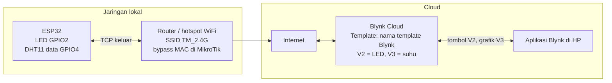

# Block Diagram Versi Blynk

Tanpa server Flask. Board bicara langsung ke Blynk Cloud.

## Keterangan

- ESP32 sebagai **client**, membuka koneksi keluar ke Blynk Cloud. Tidak ada port yang dibuka di board.
- Aplikasi Blynk di HP juga membuka koneksi ke cloud yang sama, jadi keduanya tidak perlu satu jaringan.
- `V2` menulis ke board (tombol ON/OFF), `V3` dibaca dari board (suhu tiap 5 detik).
- Tidak ada database: status LED dan suhu terakhir disimpan di server Blynk.
