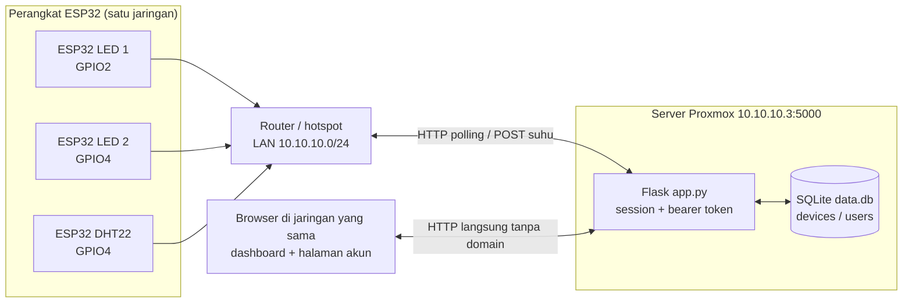

# Block Diagram Versi LAN

Tanpa domain dan tanpa Cloudflare Tunnel. Semua perangkat ada di jaringan lokal yang sama.

## Bedanya dengan versi domain

| | Versi domain (`block-diagram-1.png`) | Versi LAN (ini) |
|---|---|---|
| Alamat | `http://10.10.10.3:5000` | `http://10.10.10.3:5000` |
| Lewat internet | ya, Cloudflare Tunnel | tidak |
| Butuh internet | ya | tidak |
| Latensi | kena jalur Cloudflare | langsung di LAN |
| Sertifikat TLS (versi https) | perlu CA di sketch | tidak perlu |

Catatan teknis: di LAN, `WiFi.config` dengan DNS `9.9.9.9` tetap boleh dipakai, tapi tidak lagi berpengaruh karena host tujuannya IP, bukan nama domain.
