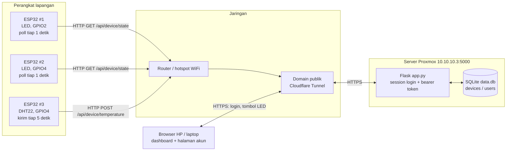
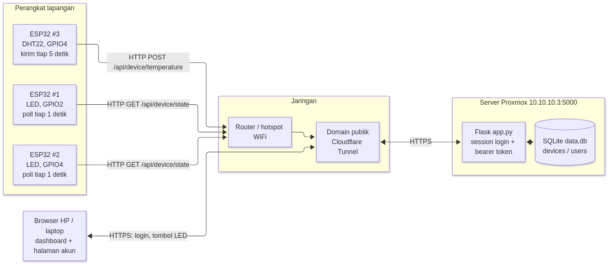

# Block Diagram Sistem IoT LED & Suhu

Komponen dan jalur komunikasi yang dipakai aplikasi saat ini.

## Keterangan

- ESP32 adalah **client**, server tidak pernah menghubungi board. Board yang bertanya tiap 1 detik.
- Satu token = satu device. Token dikirim sebagai header `Authorization: Bearer <token>`.
- LED: server membalas `{"on": true|false}`, board yang menyalakan GPIO.
- Suhu: arah data terbalik, board mengirim `{"celsius": 26.5}`.
- `data.db` menyimpan token device (hash + plaintext) dan akun dashboard.

