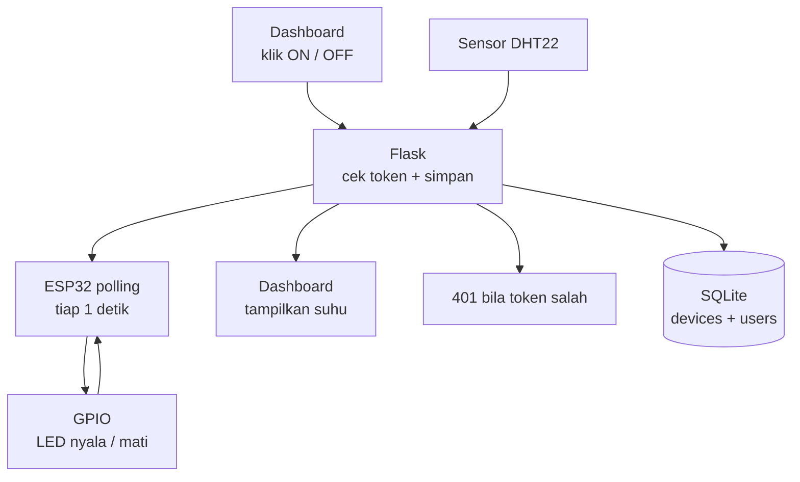

# Flowchart Ringkas (untuk presentasi)

Satu gambar, alur inti sistem. Versi rinci tetap ada di `flowchart.md`.

## Kalimat pengantar saat presentasi

- Pengguna menekan tombol di dashboard, Flask menyimpannya ke SQLite.
- ESP32 tidak pernah "disuruh" server. Board bertanya sendiri tiap 1 detik dengan bearer token.
- Token dicek ke database; kalau tidak cocok, server membalas 401 dan tidak ada aksi.
- Untuk suhu arahnya terbalik: DHT22 membaca, ESP32 yang mengirim ke server tiap 5 detik, dashboard menampilkan angka terakhir.

Gambar: `flowchart-ringkas.png` (1600 x 1046, latar putih).
