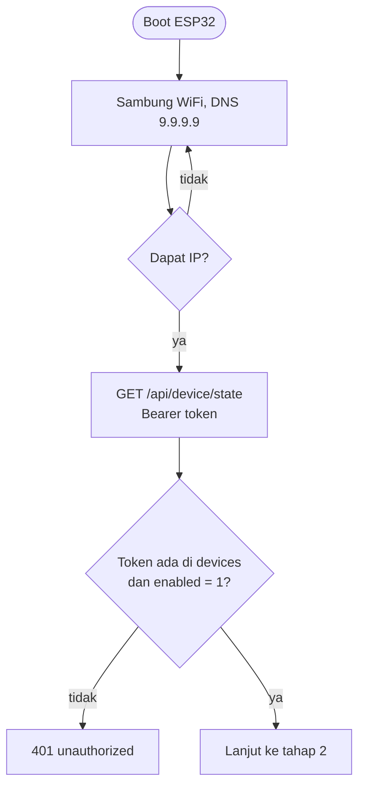
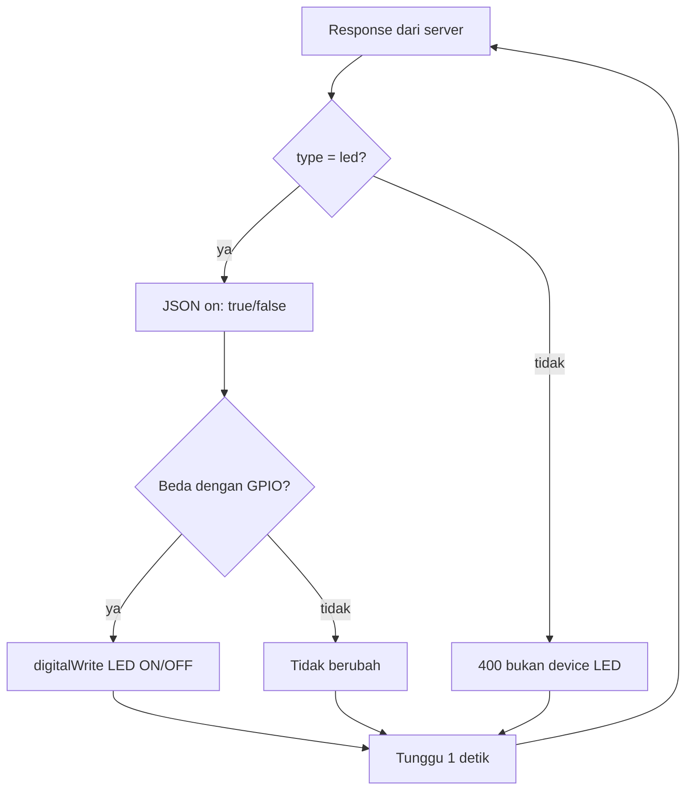
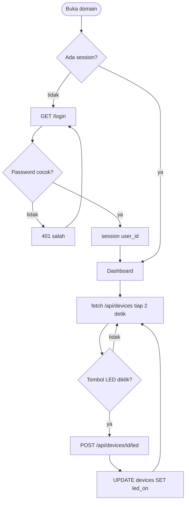
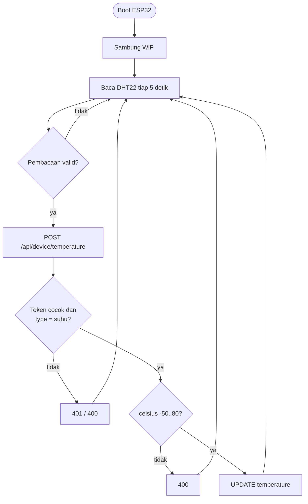

# Flowchart Sistem IoT LED & Suhu

Empat alur, masing-masing satu gambar siap tempel.

## 1. Koneksi dan autentikasi (ESP32)

## 2. Aksi LED di board

## 3. Alur pengguna di dashboard

## 4. Kirim suhu (ESP32 + DHT22)

## File gambar

| File | Isi |
|---|---|
| `flowchart-1.png` | koneksi + autentikasi ESP32 |
| `flowchart-2.png` | aksi LED di board |
| `flowchart-3.png` | alur pengguna dashboard |
| `flowchart-4.png` | kirim suhu DHT22 |
